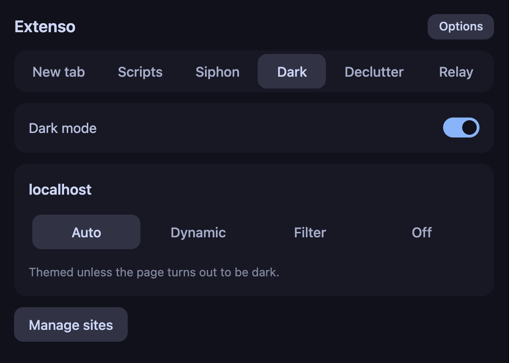
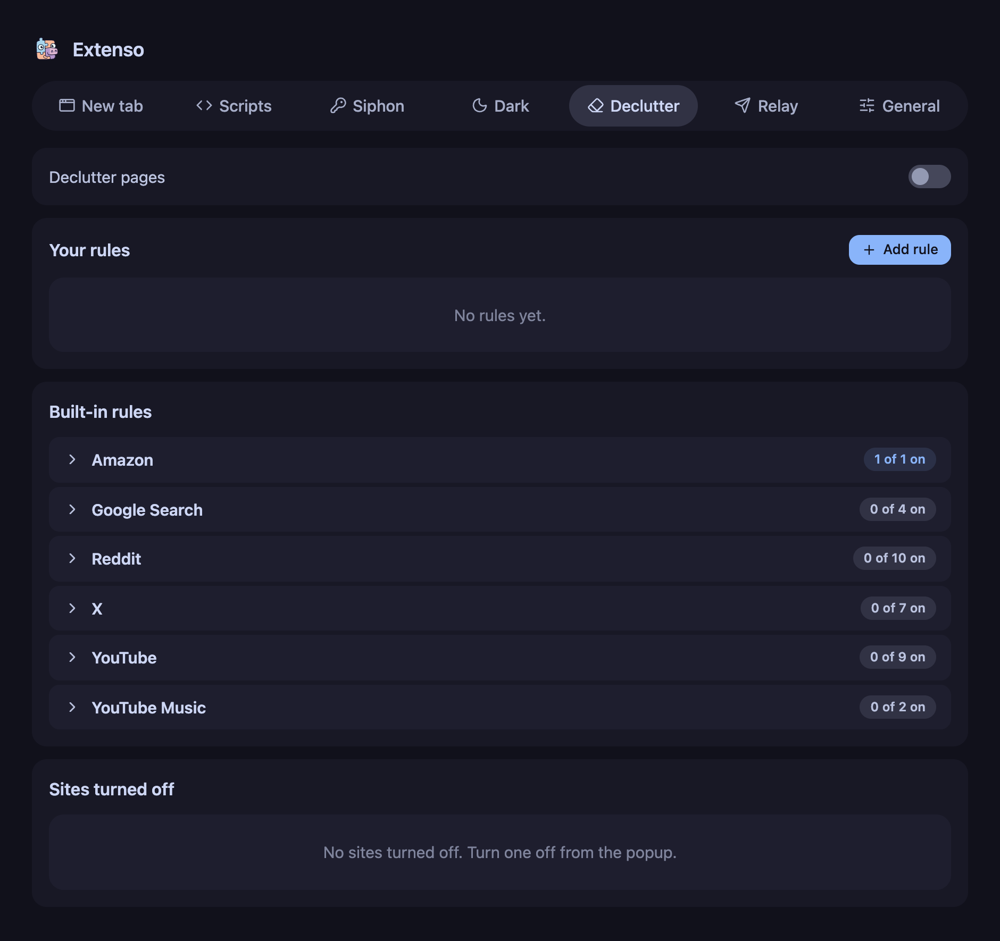

<div align="center">
  
  <h1>Extenso</h1>

  <a href="https://github.com/Tanq16/extenso/actions/workflows/release.yaml"></a><br><br>
  <a href="#features">Features</a> &bull; <a href="#screenshots">Screenshots</a> &bull; <a href="#install">Install</a> &bull; <a href="#usage">Usage</a> &bull; <a href="#notes">Notes</a>
</div>

---

Extenso is a Manifest V3 Chrome extension that bundles a new tab redirect, bookmarklets, token capture, dark mode, page declutter, and a relay to HTTP servers. It is a personal toolkit loaded unpacked, not a Chrome Web Store extension.

Siphon reads cookies, headers, request and response bodies, and page storage on sites its rules name or tabs its DevTools panel inspects. It is meant for capturing your own session tokens, on accounts you are authorized to use.

## Features

- **New tab** opens a URL of your choice in place of Chrome's new tab page.
- **Scripts** stores bookmarklets and user scripts, runs manual ones from the popup or the right-click menu, and runs automatic ones on matching pages, with 14 built-in scripts for any page, YouTube, and Reddit.
- **Siphon** captures a value from a query parameter, header, body, cookie, or web storage whenever a matching request or page appears.
- **Siphon's DevTools panel** turns any field of a recorded request, cookie, or storage entry into a prefilled rule.
- **Dark mode** themes light pages and leaves dark ones alone, with a per-site choice of Auto, Always, Invert, or Never.
- **Declutter** hides or removes page elements by CSS selector on matching URLs, with 32 built-in rules for sites such as Google Search, Reddit, X, and YouTube.
- **Relay** sends the page text, the selection, or a link as JSON to an HTTP endpoint you define.
- **Settings export and import** moves every module's settings as one JSON file.

## Screenshots

<details>
<summary>Click to expand</summary>

### Popup

| Popup |
| :---: |
|  |

### Options page

| Options page |
| :---: |
|  |

</details>

## Install

### Release zip

1. Download `extenso-<version>.zip` from the [latest release](https://github.com/Tanq16/extenso/releases/latest) and unzip it into its own folder.
2. Open `chrome://extensions` and turn on Developer mode.
3. Click Load unpacked and select that folder.

Chrome runs the extension from that folder, so keep it in place. To update, replace the folder's contents and reload the extension from `chrome://extensions`.

### From the repository

```bash
git clone https://github.com/Tanq16/extenso.git
```

Load the cloned folder unpacked, as in steps 2 and 3 above. There is no build step, and `make dev` prints the same instructions.

Building the release zip locally needs `make`, `jq`, and `zip`:

```bash
make build VERSION=v1.0.0
```

This writes `dist/extenso-v1.0.0.zip` with that version stamped into its manifest. Without `VERSION`, it uses the version in `manifest.json`.

### Allow User Scripts

Turn on "Allow User Scripts" on the extension's details page after either install. Scripts cannot run without it, and the Scripts tab shows an Open details button until it is on.

## Usage

The toolbar popup has a tab per module with its on/off switch and controls for the current page. Its Options button opens the options page, which holds each module's settings and lists, plus a General tab for export and import. A module that is off injects nothing into pages. Declutter and Relay start off. Match pattern fields use Chrome's match pattern syntax, such as `https://github.com/settings/*`.

### New tab

Set the redirect URL on the options page. A URL without a scheme gets `https://` prepended.

### Scripts

| Field | Values |
|---|---|
| Code | Raw JavaScript, or a pasted `javascript:` bookmarklet URL, which is decoded |
| Trigger | Manual or Automatic |
| World | User script (isolated) or Main (page), which shares the page's JavaScript globals |
| Run at | Document idle, end, or start, for automatic scripts only |
| Match patterns | Where an automatic script runs, or where a manual one is offered |

- **Built-in scripts** are grouped by site on the options page. The manual ones for any page start on, and the automatic ones for YouTube and Reddit start off. Customize copies one into your scripts for editing.
- **Manual scripts** appear with a Run button in the popup on matching pages, and under Run script in the right-click menu. A failure from the menu shows a notification.
- **Automatic scripts** are registered with Chrome and run on every matching page load, each in its own function scope so top-level names never clash. One that Chrome rejects shows a Not registered badge on the options page.
- **Run on the options page** runs the script on the most recently used web tab.

### Siphon

A rule has a name, a scope match pattern with an optional URL regex, a source, a key, an extract mode, and how many values to keep.

| Source | Key | Read |
|---|---|---|
| Query param | Parameter name | From the request URL |
| Request header | Header name | From outgoing requests |
| Request body | Form field or JSON key | From outgoing requests |
| Response header | Header name | From responses |
| Response body | JSON key, optional | From fetch and XHR responses made by page scripts |
| Cookie | Cookie name | Each time the cookie is set |
| localStorage, sessionStorage | Storage key, required | On page load and when the tab regains focus |

- **An empty key** captures the whole source, such as every header or the full query string.
- **Extract** takes the whole value, a regex's `value` named group or group 1, or a JSON path such as `data.access_token`.
- **Keep** holds the latest value or the last N. A value equal to the latest one is not recorded again.
- **On capture**, a rule can show a notification, copy the value to the clipboard, or both.
- **The popup** shows each rule's latest capture with a Copy button. Clear empties all captures.

The Siphon panel in DevTools records requests while DevTools is open, filterable by host. Selecting a request lists its query parameters, headers, body fields, and response JSON keys, along with the page's cookies and storage. Clicking any entry opens a prefilled rule. Find by value searches all of them for a value you already have.

### Dark mode

The popup sets the mode for the current site. Changing it reloads that site's open tabs.

| Mode | Behavior |
|---|---|
| Auto | Themes the page unless it is detected as dark |
| Always | Always recolors the page's styles |
| Invert | Inverts colors but not images, for sites that Always breaks |
| Never | Never themes |

- **Detected dark sites** are left unthemed for 30 days by default, then checked again before any theming. The options page sets that period and lists the remembered sites.
- **Known dark sites** from Dark Reader's bundled list are never themed in Auto.
- **Check again** in the popup forgets the current site's dark verdict and reloads the tab.

### Declutter

- **Built-in rules** are grouped by site on the options page. All start off except Amazon sponsored results.
- **Hide selectors** get `display: none` on pages matching the rule.
- **Remove selectors** delete elements from the page, including ones added after load.
- **The popup** lists the rules matching the current page with toggles, and counts the elements hidden and removed.
- **Declutter this site** in the popup turns Declutter off for the current site. The options page lists those sites.

### Relay

A target has a name, an `http` or `https` URL, a method of POST, PUT, or PATCH, optional headers, and what it sends.

| Sends | JSON body |
|---|---|
| Page | `{ url, title, text }` with the page's text |
| Selection | `{ url, title, text }` with the selected text |
| Link | `{ url, pageUrl }` |

- **Each enabled target** gets a right-click menu entry, such as "Send page to" followed by its name. A notification reports the server's status code.
- **The popup** has a Send button per enabled target. Link targets sent from the popup send the current tab's URL.
- **Test** on the options page sends a sample payload. Requests time out after 10 seconds.

### Settings export and import

Export on the General tab downloads `extenso-settings-<date>.json`. Siphon captures and the dark site cache are not included. Import replaces the settings of each module in the file and leaves the other modules as they are.

## Notes

- **Declutter** keeps a matching page blank while it loads, until its rules apply, so hidden elements never flash.
- **Dark mode site fixes** come from Dark Reader for the hosts in `modules/dark/fixes-allowlist.txt`. Other sites may look worse under the dynamic engine.
- **New site fixes** are pulled by adding a host to the allowlist and running `node tools/sync-darkreader-data.mjs <darkreader-checkout>`.
- **Personal site fixes** go in `modules/dark/fixes.local.config`, in Dark Reader's fix format.
- **Dark mode** is ported from Dark Reader, whose MIT license is in `third_party/darkreader/LICENSE`.
- **Icons** come from Lucide 1.61.0, whose ISC license is in `third_party/lucide/LICENSE`.
